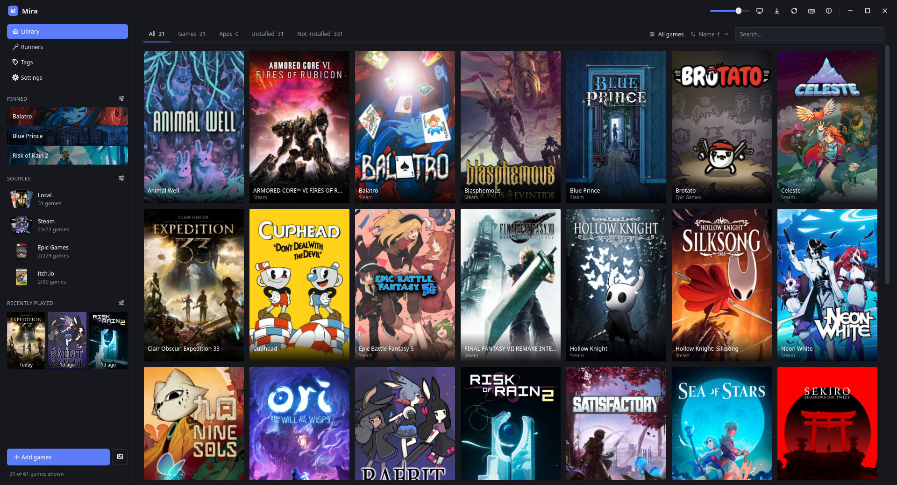
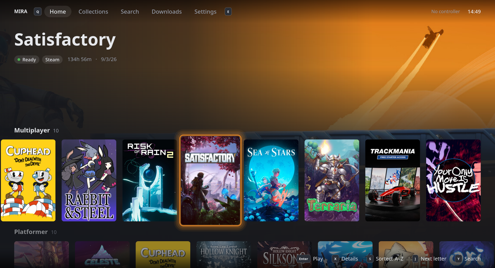
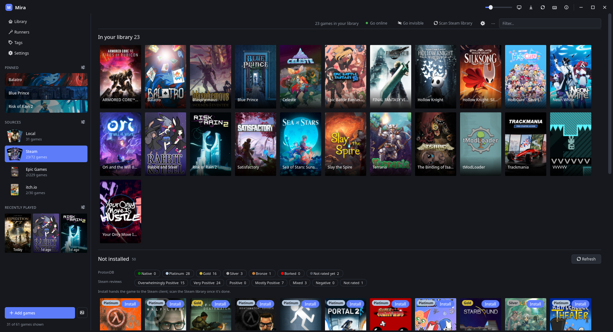
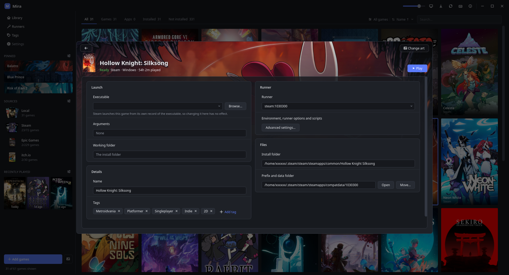
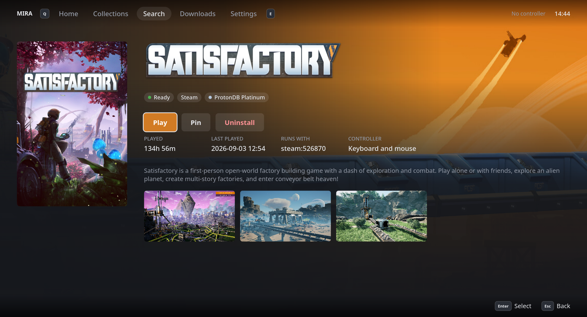

<div align="center">


# Mira

**One library for every game and app on your Linux PC.**

Native games, Windows games through Wine and Proton, and your Steam, Epic, GOG, itch.io, Amazon and Humble libraries, side by side in one place. Windows apps like Microsoft 365 and Adobe Creative Cloud can live there too.

[](https://github.com/Mira-Launcher/Mira/releases/latest)
[](LICENSE)
[](#install)

[Install](#install) · [Features](#features) · [Build from source](#build-from-source) · [Docs](docs/)

</div>

## What Mira does

Mira is a game launcher for Linux. Drop a game folder into a watched directory and Mira notices it, works out which program starts it, picks a runner, sets up a Wine prefix if it needs one and adds it to your library with its cover art. Sign in to your stores and their games join the same library, installed or not, so there's one place to find, install and play everything you own, and the Windows apps you need can sit alongside it.

It's built for both a desk and a couch: a mouse-and-keyboard library window, and a big screen mode for a TV or a Steam Deck that you drive with a controller.

<p align="center">
&nbsp;&nbsp;&nbsp;
</p>

## Features

### One library, every source

- **Stores:** Steam, Epic Games, GOG, itch.io, Amazon Games and Humble Bundle. Sign in, import what's installed, and install or download the rest from the store's page in Mira.
- **Launchers:** Battle.net, Ubisoft Connect and the EA app, each installed into its own Wine prefix and kept separate from your games.
- **Emulators:** DuckStation, PCSX2, PPSSPP, RPCS3, shadPS4, KytyPS5, Dolphin, Cemu, Eden, Ryujinx, Azahar, melonDS, xemu, Xenia Canary, Flycast, Mesen, Snes9x, bsnes, mGBA, ares, BlastEm, RMG, Vita3K, Ymir, Mednafen, Stella, MAME, Mupen64Plus, Redream, atari800, Hatari, FS-UAE, VICE, openMSX, UZDoom, EasyRPG Player, DOSBox Staging and ScummVM. Mira sets each one up from its releases page or your system's packages, and the games you add (pick them, drop them on its page or put them in its folder) launch like any other.
- **Bring your own:** watched library folders, games added by hand, existing desktop entries and your Lutris library.
- **Applications too:** Microsoft 365 and Adobe Creative Cloud (on [AdobeWine](https://github.com/le-birnes/AdobeWine)) install into their own prefixes, and their apps launch like games while staying out of the games view.

<div align="center">

<br>
<sub>A store page: what's installed, then everything else you own, filterable by ProtonDB tier and Steam reviews.</sub>
</div>

### Windows games and apps without the setup

- **Automatic detection:** Mira scores the executables in a new folder, spots installers (Inno Setup, NSIS, MSI and more) and offers to run them, quietly where the format allows.
- **Proton and Wine, handled:** Proton runs through `umu-run`, and Mira picks a sensible build (distro packages first, then GE-Proton or Wine staging-tkg). The Runners page downloads and updates builds from GitHub with checksums, and a working game stays pinned to its build when a newer one arrives.
- **Steam games** launch with the Proton build and prefix Steam already set up for them.
- **Winetricks, GameMode, scripts and environment variables** per game or for everything.

<div align="center">

<br>
<sub>A game's card: how it launches, its runner, its tags and where its files and prefix live.</sub>
</div>

### Big screen mode

A full-screen, controller-friendly view for the TV or a handheld: each game's hero art behind it, rows for continue playing, pinned games and collections, search, downloads and settings, all reachable with a gamepad or the keyboard.

<div align="center">

</div>

### Looks after your library

- **Cover art** from Steam and SteamGridDB, with a picker to choose a different cover or hero for any game.
- **Ratings at a glance:** ProtonDB tiers and Steam review scores on tiles and hover cards.
- **Tags and folders:** tag games yourself or from Steam's tags, and optionally have Mira sort a library folder into a subfolder per tag, keeping folders and tags in step.
- **Playtime and crash tracking** for every launch, even when Mira itself is closed, plus logs of each game's last run.
- **Menu entries:** each ready game or app gets an entry in your desktop's app menu.
- **Hidden games, pins and recently played** in the sidebar, and keyboard shortcuts for everything, all rebindable.

### Light, and scriptable

- **Costs nothing when idle.** The daemon waits on the kernel (inotify, condition variables) rather than polling, and closing the window hides Mira to the tray.
- **Everything the GUI does, the CLI does too.** `mirad` serves a REST API on a Unix socket, the GUI and the `mira` command are both clients of it, and every endpoint has a matching command. See [`docs/cli.md`](docs/cli.md) and [`docs/api.md`](docs/api.md).

```sh
mira list --tag favorite
mira launch celeste
mira runners download --kind proton --tag GE-Proton10-1
```

## Install

Download the latest release from the [releases page](https://github.com/Mira-Launcher/Mira/releases/latest). Builds run on Ubuntu 22.04 and newer, and on any distribution of the same age or later.

| Package | Install |
|---|---|
| **AppImage** | `chmod +x Mira-x86_64.AppImage`, then `./Mira-x86_64.AppImage setup` adds a menu entry and a `mira` command (`setup --remove` undoes it). |
| **.deb** (Debian, Ubuntu, Mint) | `sudo apt install ./mira-launcher_*_amd64.deb` |
| **.rpm** (Fedora, openSUSE) | `sudo dnf install ./mira-launcher-*.x86_64.rpm` |
| **Arch** | `makepkg -si` with [`packaging/PKGBUILD`](packaging/PKGBUILD) |

On first launch, *Set up Mira* walks through where to keep games, any system packages that are missing, the stores to sign in to and how the library should look. Every step can be skipped.

## Build from source

Needs a C++23 compiler, CMake 3.20+, Ninja, and Qt6 6.5+ (`Widgets`, `Multimedia`) for `mira-gui`. Other dependencies are vendored.

```sh
cmake --preset dev
cmake --build build/dev
build/dev/mira-gui
```

Binaries land in `build/dev/`. Other presets are `release`, `asan` and `tsan`, and `cmake --build build/dev --target run-gui` builds and starts the GUI.

`mira-gui` starts `mirad` itself and keeps it running from the tray. A `mira` command run while Mira is closed opens it in the tray first (or, with no desktop, starts `mirad` for that command only):

```sh
build/dev/mira list
```

### AppImage, .deb and .rpm

```sh
cmake --preset release
cmake --build build/release --target appimage
```

This builds in an Ubuntu 22.04 container (docker or podman; nothing else is needed on the host, not even Qt), so the results run on Ubuntu 22.04 and newer. `build/release/appimage/` gets `Mira-x86_64.AppImage`, the `.deb` and the `.rpm`. The first run builds the image with GCC 13 and Qt 6.8 (`packaging/appimage/Dockerfile`), which takes a while; later runs reuse it and its compiler cache.

`--target appimage-host` (and `packages-host`) builds with the machine's own Qt and libraries instead: quicker, but the result only runs on distributions as new as that machine, so it's not for releases. It needs Qt6 and `curl`.

### Tests

```sh
cmake --build build/dev --target mira_tests
ctest --test-dir build/dev
```

Run the suite under the `tsan` preset for changes to anything shared across threads (`Config`, `GameStore`, `EventBus`).

## How it fits together

The repository has three programs: the daemon `mirad`, which owns all state and does all the work, the CLI `mira` and the Qt frontend `mira-gui`. Both clients talk to `mirad` over a REST API on a Unix socket, so anything the GUI can do also works from a terminal or a script.

- [`docs/architecture.md`](docs/architecture.md): how the pieces fit, storage, detection, runners and launching.
- [`docs/frontend.md`](docs/frontend.md): the GUI's structure and UX principles.
- [`docs/api.md`](docs/api.md): the REST API.
- [`docs/cli.md`](docs/cli.md): every `mira` command.

## Your data

Everything lives in `~/.config/mira/` (`$XDG_CONFIG_HOME/mira`): `settings.toml` (backend settings), `mira.db` (the library, an SQLite database, with `mira.db.bak` as a copy from the last start), `cache.db` and `artwork/` (fetched store info and art) and `frontend.toml` (GUI settings). Back that directory up to keep all state; delete it to start fresh.

## License

Mira is free software under the [GPLv3](LICENSE).
